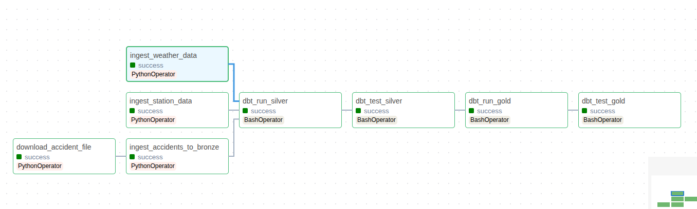
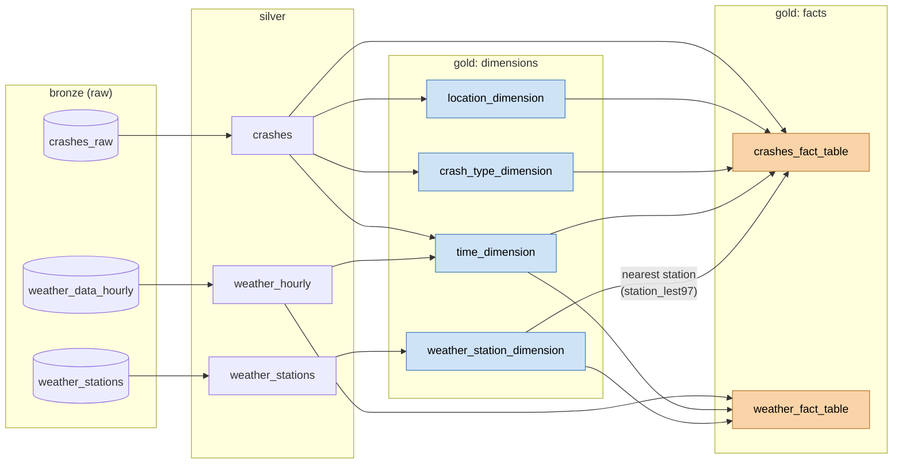
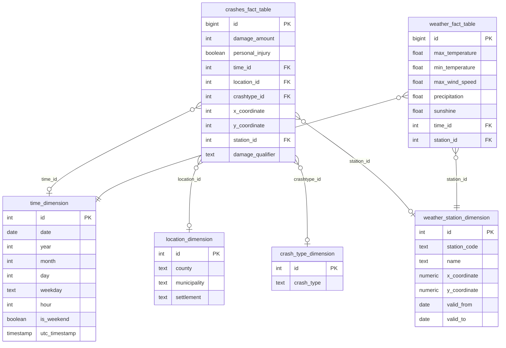
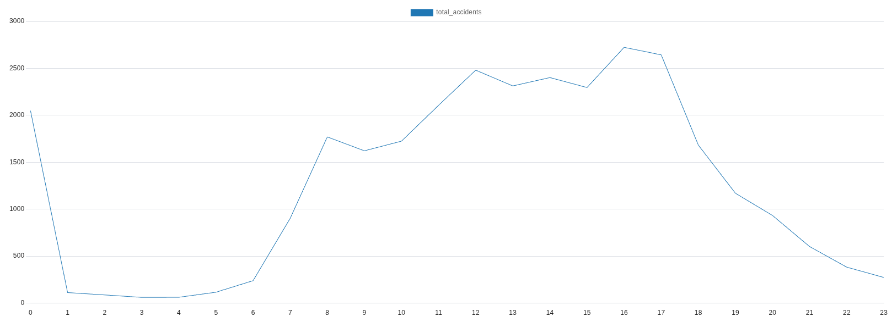
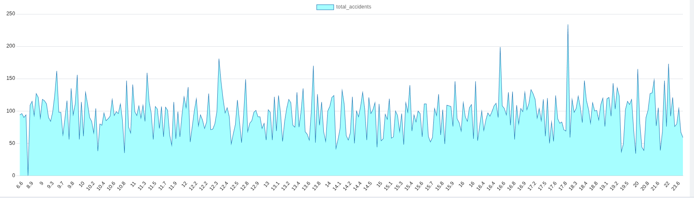

# data-eng-project-weather-crashes
Data Engineering course project at the University of Tartu: analyzing the relationship between weather conditions and traffic crashes.
## Datasets
For this project we use three datasets:
### 1) Weather data 2026 from Estonia form Ilmateenistus, Keskkonnaagentuur https://www.ilmateenistus.ee/kliima/ajaloolised-ilmaandmed/ 
- Data per one hour for every weather station, pulled once a day
- API pull as a .json file
### 2) Traffic accident data about the year 2026 from The Estonian Motor Insurance Bureau, https://kaart.lkf.ee/
- API pull as a .csv file
### 3) Weather station coordinates from the keskkonnaandmed API
- Pulled once to match coordinates to weather station code and name
- API request to this endpoint: https://keskkonnaandmed.envir.ee/f_kliima_jaam_vaatlus?select=jaam_kood,jaam_nimi,jaam_nimi_eng,pikkuskraad,laiuskraad,korgus_merepinnast_m,jaam_periood_algus,jaam_periood_lopp 

## Team members
* Triinu Vaher
* Laura Laugma
* Triine Kose
* Kaaren Tenson
* Raio Mitt

## How to run
1. Start the containers: [docs/startup.md](docs/startup.md). The environment variables
   (database users, passwords and ports) are also described there.
2. Open Airflow at http://localhost:8080 (`airflow` / `airflow`) and trigger the
   `full_pipeline` DAG manually (▶).
3. Go to pgAdmin at http://localhost:5051 (`admin@example.com` / `admin`) to check out
   the changes in the database (schemas `raw`, `silver` and `gold` in `weather_db`).
   The server connection settings are in [docs/startup.md](docs/startup.md#3-databases).


## Pipeline overview

Bronze (raw API data, loaded by Airflow) → silver (cleaned, dbt) → gold (star schema, dbt).

### Airflow DAGs
[`full_pipeline`](src/dags/full_pipeline.py) runs everything in one go:
the three bronze loads in parallel, then silver, then gold (each dbt layer is tested
before the next one starts).



The single steps are also separate DAGs in [`src/dags/steps/`](src/dags/steps/), for
re-running one part only: `fetch_station_data_pipeline`, `fetch_weather_data_pipeline`,
`ingest_accident_data_pipeline` (bronze), `dbt_silver_pipeline` and `dbt_gold_pipeline`.

### dbt models and dependencies
The models, their fields and tests are documented in YAML:
[gold](src/dbt_project/models/gold/schema.yml),
[silver](src/dbt_project/models/silver/schema.yml),
[sources](src/dbt_project/models/sources.yml).

Lineage: how the data flows from bronze to gold (left to right, an arrow means
"is used to build"):



Left out to keep the picture readable: `weather_hourly` also reads `weather_stations`
(it keeps only known stations), and `station_lest97` is an ephemeral helper (not a
table) that converts station coordinates to L-EST97 for the nearest-station lookup.
`dbt ls --select +<model>` or the dbt docs graph shows the complete list.

Gold star schema (primary keys and foreign keys, enforced in the database):



## Example analytical queries

### 1. Do the rainy or snowy weather conditions increase the number of traffic accidents?

Each weather hour (one station, one hour) is matched to the crashes in the same hour
whose nearest station is that station. The hours are split into "precipitation" and
"clear/other" (no precipitation or no measurement), and the crash rate is compared
per 1000 station-hours.

```sql
SELECT
    CASE
        WHEN w.precipitation > 0 THEN 'Precipitation (Rain/Snow)'
        ELSE 'Clear/Other'
    END AS weather_condition,
    COUNT(c.id) AS total_accidents,
    COUNT(DISTINCT w.id) AS weather_hours,
    ROUND(1000.0 * COUNT(c.id) / COUNT(DISTINCT w.id), 2) AS accidents_per_1000_hours
FROM gold.Weather_fact_table w
LEFT JOIN gold.Crashes_fact_table c
    ON c.time_id = w.time_id AND c.station_id = w.station_id
GROUP BY
    CASE
        WHEN w.precipitation > 0 THEN 'Precipitation (Rain/Snow)'
        ELSE 'Clear/Other'
    END
ORDER BY accidents_per_1000_hours DESC;
```

Result:

| weather_condition         | total_accidents | weather_hours | accidents_per_1000_hours |
|---------------------------|----------------:|--------------:|-------------------------:|
| Precipitation (Rain/Snow) |            3158 |         17544 |                   180.00 |
| Clear/Other               |           27564 |        176256 |                   156.39 |

Hours with precipitation have about 15% more crashes per hour than hours without
(180.00 vs 156.39 per 1000 station-hours).

### 2. How does the time of day affect traffic accidents?

This query links the crashes to the Time_dimension table to aggregate the total number
of accidents by the hour of the day.

```sql
SELECT
    t.hour,
    COUNT(c.id) AS total_accidents
FROM gold.Crashes_fact_table c
JOIN gold.Time_dimension t ON c.time_id = t.id
GROUP BY t.hour
ORDER BY t.hour ASC;
```

Result:



Accidents are rare at night (under 250 per hour between 01:00 and 06:00), rise sharply
in the morning (about 1,770 at 08:00), and peak in the afternoon rush hour (about 2,700
at 16:00), then fall steadily through the evening.

The spike at hour 0 is not real traffic: 1,912 crashes have the time exactly 00:00 in
the source, which is most likely a placeholder for an unknown time (any other minute
of that hour has only 10–20 crashes).

### 3. Does the daily wind speed increase the number of accidents on that day?

By grouping the data by date, we can observe the maximum wind speed recorded on that
day alongside the daily count of crashes.

```sql
SELECT
    t.date,
    MAX(w.max_wind_speed) AS max_daily_wind_speed,
    COUNT(c.id) AS total_accidents
FROM gold.time_dimension t
JOIN gold.Weather_fact_table w ON w.time_id = t.id
LEFT JOIN gold.Crashes_fact_table c
    ON c.time_id = w.time_id AND c.station_id = w.station_id
GROUP BY t.date
ORDER BY max_daily_wind_speed ASC;
```

Result (x axis: maximum wind gust of the day in m/s, from calm to stormy days;
y axis: number of accidents that day):



No clear effect is visible.
